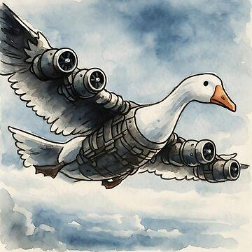

# ТЗ: Аэрогусь «Готурбо»

**Автор:** Элякова Алеся Львовна  
**Стихия:** воздух  
**Проект:** crazy-air-transport  
**Репозиторий:** https://github.com/alelyak/turbo-goose
**Дата заморозки:** не назначена  
**Версия:** 0.1

## 1. Назначение

Аэрогусь «Готурбо» — одноместное средство передвижения в форме механического гуся с усиленными машущими крыльями и хвостовым турбовентилятором. Он летает над препятствиями, расходуя запас зерновой энергии, и умеет оценивать, какие воздушные препятствия сможет преодолеть. На земле гусь может стоять и отдыхать, но перемещаться по земле не умеет: максимум — возмущённо гоготать.



## 2. Стихия и конструкционный элемент

**Стихия:** воздух.

**Конструкционный элемент:** машущие крылья, создающие подъёмную силу.

**Как реализован элемент:** публичный атрибут `wing_span_m` задаёт размах крыльев. При движении в режиме `"air"` транспорт поднимается в воздух. Если размах крыльев меньше или равен 1.5 м, транспорт не может преодолеть препятствие `"storm"`.

**Ограничения стихии:**
- Основной и единственный режим перемещения — `"air"`.
- Транспорт может находиться на земле в состоянии покоя.
- Движение по земле и по воде не поддерживается.
- Крылья являются обязательным элементом полёта; транспорт не является наземным или водным транспортом.

## 3. Публичный интерфейс

Реализация должна предоставлять описанные ниже публичные атрибуты и методы. Внутренние вспомогательные методы и атрибуты не входят в контракт и могут изменяться.

### 3.1. Класс и модуль

```python
class TurboGoose:
```

**Модуль:** `turbo_goose.py`

### 3.2. Конструктор

```python
def __init__(
    self,
    name: str,
    mass_kg: float,
    wing_span_m: float,
    max_speed_kmh: float,
    energy: float = 100.0,
) -> None:
```

| Параметр | Тип | Единица | Допустимое значение | По умолчанию |
|---|---|---|---|---|
| `name` | `str` | — | непустая строка, не состоящая только из пробелов | — |
| `mass_kg` | `float` | кг | `> 0` | — |
| `wing_span_m` | `float` | м | `> 0` | — |
| `max_speed_kmh` | `float` | км/ч | `> 0` | — |
| `energy` | `float` | зерновые единицы | от `0` до `100` включительно | `100.0` |

**Исключения конструктора:**
- `ValueError` — если `name` пустой или состоит только из пробелов.
- `ValueError` — если `mass_kg`, `wing_span_m` или `max_speed_kmh` меньше либо равны нулю.
- `ValueError` — если `energy` меньше `0` или больше `100`.

После успешного создания:
- `position_km == 0.0`;
- `is_flying is False`;
- остальные публичные атрибуты соответствуют переданным параметрам.

### 3.3. Публичные атрибуты

| Атрибут | Тип | Единица | Доступ | Описание |
|---|---|---|---|---|
| `name` | `str` | — | чтение | Имя аэрогуся |
| `mass_kg` | `float` | кг | чтение | Масса транспорта |
| `wing_span_m` | `float` | м | чтение | Размах крыльев |
| `max_speed_kmh` | `float` | км/ч | чтение | Максимальная скорость в воздухе |
| `energy` | `float` | зерновые единицы | чтение | Текущий запас энергии |
| `position_km` | `float` | км | чтение | Суммарная пройденная дистанция |
| `is_flying` | `bool` | — | чтение | Находится ли транспорт в полёте |

Публичные атрибуты доступны для чтения. Их изменение выполняется методами класса, а не прямым присваиванием извне. Прямое присваивание значения любому публичному атрибуту извне объекта должно вызывать AttributeError. Изменение состояния выполняется только предусмотренными публичными методами класса.

### 3.4. Методы

#### 3.4.1. `move`

```python
def move(self, distance_km: float, medium: str = "air") -> float:
```

**Назначение:** перемещает аэрогуся на заданную дистанцию.

**Параметры:**
- `distance_km` — дистанция в километрах, строго больше `0`;
- `medium` — среда перемещения; единственное допустимое значение — `"air"`.

**Возвращает:** время перемещения в часах (`float`), вычисленное как `distance_km / max_speed_kmh`.

**Изменяет:** `position_km`, `energy`, `is_flying`.

**Правила:**
1. Энергозатраты равны `distance_km * 2`.
2. Если энергии достаточно, `position_km` увеличивается на `distance_km`, `energy` уменьшается на энергозатраты, а `is_flying` становится `True`.
3. Если энергии недостаточно, метод выбрасывает `GooseNoEnergy`; ни один публичный атрибут не изменяется.
4. Если `medium != "air"`, метод выбрасывает `GooseCannotTravelThere`; состояние не изменяется.
5. Если `distance_km <= 0`, метод выбрасывает `ValueError`; состояние не изменяется.
6. При успешном движении время рассчитывается по максимальной скорости; отдельные погодные эффекты на скорость не влияют.
7. Проверки выполняются в следующем порядке: сначала проверяется distance_km, затем medium. Если distance_km <= 0, метод выбрасывает ValueError, даже если значение medium также недопустимо.

#### 3.4.2. `can_overcome`

```python
def can_overcome(self, obstacle: str) -> bool:
```

**Назначение:** проверяет возможность преодоления препятствия без перемещения транспорта.

**Допустимые значения `obstacle`:** `"building"`, `"storm"`, `"power_line"`.

**Возвращает:** `bool`.

**Правила:**
- `"building"` — `True`, если `is_flying is True` и `energy >= 10`; иначе `False`.
- `"storm"` — `True`, если `wing_span_m > 1.5` и `energy >= 25`; иначе `False`.
- `"power_line"` — всегда `False`: автоматика не разрешает гусю пересекать линии электропередачи.
- Неизвестное значение `obstacle` вызывает `ValueError`.

Метод не меняет состояние транспорта.

#### 3.4.3. `calculate_energy`

```python
def calculate_energy(self, distance_km: float, medium: str = "air") -> float:
```

**Назначение:** рассчитывает расход энергии для перемещения без фактического перемещения.

**Параметры:** те же, что у `move`.

**Возвращает:** расход энергии (`float`), равный `distance_km * 2`.

**Исключения:**
- `ValueError` — если `distance_km <= 0`;
- `GooseCannotTravelThere` — если `medium != "air"`.

**Правила:** 
1. метод не меняет ни один атрибут объекта и не проверяет, хватит ли текущей энергии для движения.
2. проверки выполняются в следующем порядке: сначала проверяется distance_km, затем medium. Если distance_km <= 0, метод выбрасывает ValueError, даже если значение medium также недопустимо.

#### 3.4.4. `refuel`

```python
def refuel(self, amount: float) -> None:
```

**Назначение:** пополняет запас энергии порцией зерна.

**Параметр:** `amount` — количество зерновых единиц, строго больше `0`.

**Возвращает:** `None`.

**Изменяет:** только `energy`.

**Правила:** новое значение энергии равно `min(100.0, energy + amount)`. Запас энергии не может превышать `100.0`.

**Исключения:** `ValueError`, если `amount <= 0`. При исключении состояние не меняется.

#### 3.4.5. `land`

```python
def land(self) -> None:
```

**Назначение:** переводит аэрогуся из состояния полёта в состояние покоя на земле.

**Возвращает:** `None`.

**Изменяет:** `is_flying` становится `False`. Остальные атрибуты не меняются.

Вызов `land()` допустим и тогда, когда транспорт уже находится на земле; в этом случае состояние остаётся прежним.

#### 3.4.6. `get_status`

```python
def get_status(self) -> dict:
```

**Назначение:** возвращает снимок текущего состояния транспорта.

**Возвращает:** новый словарь со следующими ключами и типами значений:

| Ключ | Тип | Значение |
|---|---|---|
| `"name"` | `str` | Имя транспорта |
| `"energy"` | `float` | Текущая энергия |
| `"position_km"` | `float` | Пройденная дистанция |
| `"is_flying"` | `bool` | Состояние полёта |
| `"wing_span_m"` | `float` | Размах крыльев |

Каждый вызов возвращает новый словарь. Изменение возвращённого словаря не меняет состояние самого аэрогуся.

## 4. Сценарии

### 4.1. Модульные сценарии (AAA)

#### Сценарий 1. Первый полёт

**Arrange:** создан аэрогусь с `max_speed_kmh=60`, `energy=100`, `position_km=0`.

**Act:** вызвать `move(30, "air")`.

**Assert:**
- метод возвращает `0.5`;
- `position_km == 30`;
- `energy == 40`;
- `is_flying is True`.

#### Сценарий 2. Энергии не хватает

**Arrange:** создан аэрогусь с `max_speed_kmh=60`, `energy=10`, `position_km=0`.

**Act:** вызвать `move(10, "air")`.

**Assert:**
- выбрасывается `GooseNoEnergy`;
- `position_km == 0`;
- `energy == 10`;
- `is_flying is False`.

#### Сценарий 3. Расчёт без движения

**Arrange:** создан аэрогусь с `energy=80`, `position_km=0`.

**Act:** вызвать `calculate_energy(12, "air")`.

**Assert:**
- результат равен `24`;
- `energy == 80`;
- `position_km == 0`;
- `is_flying is False`.

#### Сценарий 4. Переполнение зернового бака

**Arrange:** создан аэрогусь с `energy=90`.

**Act:** вызвать `refuel(25)`.

**Assert:** `energy == 100`, а не `115`.

### 4.2. Функциональные сценарии (GWT)

#### Сценарий 5. Доставка торта на крышу

**Given:** аэрогусь «Готурбо» имеет `max_speed_kmh=50`, `wing_span_m=2.0`, `energy=80` и находится на земле.

**When:** аэрогусь летит `10` км в среде `"air"`.

**Then:**
- время полёта равно `0.2` часа;
- `position_km == 10`;
- `energy == 60`;
- `is_flying is True`.

**When:** пилот проверяет препятствие `"building"`.

**Then:** результат `True`, потому что гусь в полёте и энергии не меньше `10`.

**When:** пилот вызывает `land()`.

**Then:** `is_flying is False`; энергия и дистанция не меняются.

#### Сценарий 6. Гроза и очень серьёзный гусь

**Given:** аэрогусь имеет `wing_span_m=2.0`, `energy=30` и находится на земле.

**When:** вызывается `can_overcome("storm")`.

**Then:** результат `True`; состояние объекта не меняется.

**When:** аэрогусь выполняет `move(3, "air")`.

**Then:** `energy == 24`, `position_km == 3`, `is_flying is True`.

**When:** снова вызывается `can_overcome("storm")`.

**Then:** результат `False`, потому что энергии меньше `25`; состояние объекта не меняется.

#### Сценарий 7. Линия электропередачи — не для гусей

**Given:** создан аэрогусь с `energy=100`, `wing_span_m=3.0`. После создания гусь находится на земле: `is_flying == False`, `position_km == 0`.

**When:** вызывается `move(1, "air")`.

**Then:**

* `energy == 98`;
* `position_km == 1`;
* `is_flying is True`.

**When:** сохраняется текущее состояние и вызывается `can_overcome("power_line")`.

**Then:**

* метод возвращает `False`;
* `energy`, `position_km` и `is_flying` не изменяются в результате проверки препятствия.

**When:** вызывается `move(1, "ground")`.

**Then:**

* выбрасывается `GooseCannotTravelThere`;
* состояние гуся не изменяется.


## 5. Граничные случаи

Все перечисленные случаи должны быть покрыты тестами.

- `move(0, "air")` → `ValueError`; состояние не меняется.
- `move(1, "ground")` → `GooseCannotTravelThere`; состояние не меняется.
- `move(50, "air")` при `energy=100` → успешное перемещение, `energy == 0`, `position_km == 50`.
- `move(1, "air")` при `energy=1.9` → `GooseNoEnergy`; состояние не меняется.
- `refuel(1000)` при `energy=50` → `energy == 100`.
- `can_overcome("storm")` при `wing_span_m == 1.5` и `energy=100` → `False`.
- `can_overcome("storm")` при `wing_span_m == 1.6` и `energy == 25` → `True`.
- `can_overcome("storm")` при `wing_span_m == 1.6` и `energy == 24.9` → `False`.
- `can_overcome("unknown")` → `ValueError`.
- `refuel(0)` → `ValueError`; энергия не меняется.

## 6. Исключения

### 6.1. Иерархия доменных исключений

```text
CrazyVehicleError(Exception)
└── TurboGooseError(CrazyVehicleError)
    ├── GooseNoEnergy
    └── GooseCannotTravelThere
```

`ValueError` используется для недопустимых значений параметров и неизвестных названий препятствий. Доменное исключение используется для ситуации, когда действие невозможно по правилам транспорта.

### 6.2. Таблица исключений

| Ситуация | Исключение | Требование к состоянию |
|---|---|---|
| Имя пустое или состоит из пробелов | `ValueError` | Объект не создаётся |
| `mass_kg <= 0`, `wing_span_m <= 0` или `max_speed_kmh <= 0` | `ValueError` | Объект не создаётся |
| `energy` вне диапазона `0..100` | `ValueError` | Объект не создаётся |
| `distance_km <= 0` | `ValueError` | Состояние не меняется |
| Передана среда, отличная от `"air"` | `GooseCannotTravelThere` | Состояние не меняется |
| Энергии недостаточно для перемещения | `GooseNoEnergy` | Состояние не меняется |
| Передан неизвестный тип препятствия | `ValueError` | Состояние не меняется |
| `refuel(amount)` при `amount <= 0` | `ValueError` | Состояние не меняется |

### 6.3. Сообщения доменных исключений

- `GooseNoEnergy`: `"Готурбо вымотался: сначала покорми гуся!"`
- `GooseCannotTravelThere`: `"Готурбо умеет летать, а не ползать."`

Для `ValueError` точный текст сообщения не является частью контракта; тесты проверяют тип исключения.

## 7. Вне рамок проекта

- Графический интерфейс, анимация и реальная физическая симуляция полёта.
- Реальные погодные данные и изменение скорости из-за погоды.
- Сохранение состояния в файл или базу данных.
- Одновременная перевозка нескольких пассажиров.
- Реальное управление двигателями, крыльями или GPS.
- Реализация «пилота» как отдельного пользовательского приложения.

## 8. Открытые вопросы

На момент версии `0.1` открытых вопросов по публичному контракту нет. Если в ходе ревью будут обнаружены неоднозначности или противоречия, они фиксируются в ответах автора и разрешаются до заморозки ТЗ.

## 9. Правило изменения документа

До заморозки используется версия `0.x`. После заморозки изменения публичного контракта допускаются только с записью в `CHANGELOG.md` и соответствующим regression-тестом. Версия после заморозки становится `1.0`.
